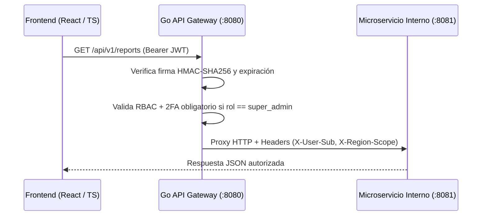

# Go JWT API Gateway & RBAC Middleware Blueprint


Arquitectura ligera de **API Gateway en Go (Golang)** construida 100% sobre la librería estándar (`net/http`, `httputil.ReverseProxy`, `crypto/hmac`) para enrutar microservicios con validación de tokens **JWT**, control de acceso basado en roles (**RBAC**), propagación de alcance regional (`X-Region-Scope`) y exigencia estricta de **2FA TOTP** para roles privilegiados (`super_admin`).

---

## Flujo de Seguridad y Enrutamiento



## Características Clave

* **Cero Dependencias Externas:** Sin *bloat* de frameworks; usa el enrutador mejorado de Go 1.22 (`GET /health`) y `httputil.NewSingleHostReverseProxy`.
* **Prevención de Bypass MFA:** Bloquea cualquier token con rol `super_admin` que no tenga el *claim* `mfa_verified: true`.
* **Propagación de Contexto y Alcance Regional:** Inyecta cabeceras verificadas hacia los servicios internos para filtrado de datos multi-región.
* **Imagen Docker Multi-Stage Ultraligera:** Compilación estática (`CGO_ENABLED=0`) sobre `alpine:3.20` (< 15 MB) con CI automatizado en GitHub Actions (`go test -race`).

## Pruebas y Ejecución

```bash
go test -v -race ./...
docker compose up --build -d
```

---

## Autor

**Jesús A. Soto Noto** — Desarrollador de Software Full Stack  
[LinkedIn](https://www.linkedin.com/in/jesus-soto-noto) · [GitHub](https://github.com/Jesus-Soto-Noto)
